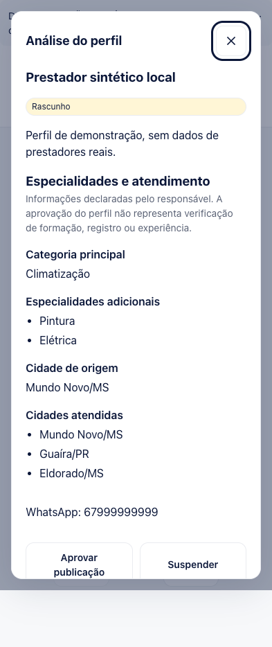
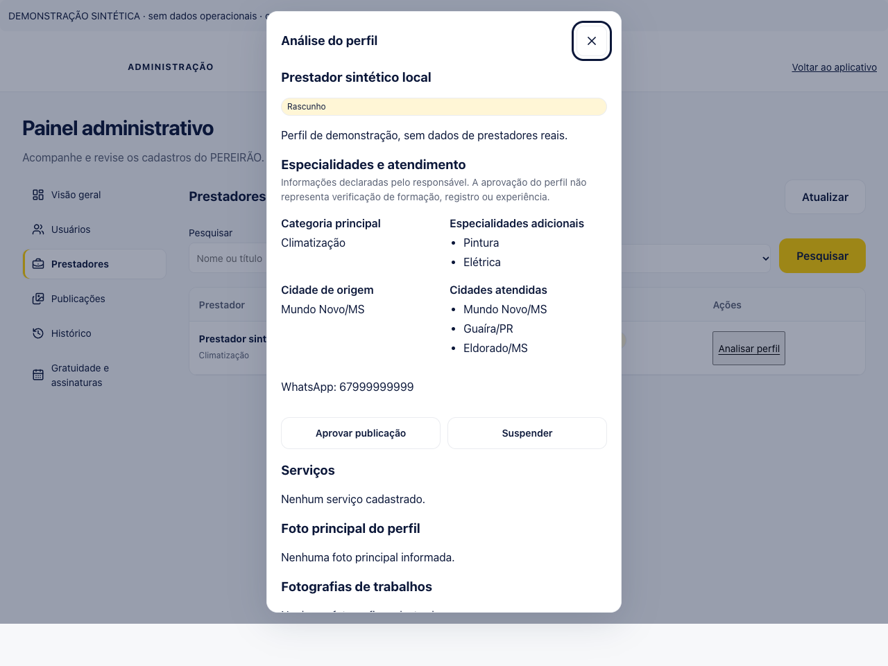

# Especialidades e atendimento na análise administrativa

A análise de perfil não recebia especialidades adicionais ou áreas de atendimento,
portanto não bastava adicionar rótulos na tela. A API passa a complementar `detail`
com `admin_review_catalog`, mantendo o usuário autenticado e a chave publishable.
Não há service_role ou consulta administrativa pelo frontend.

A nova seção mostra categoria principal, todas as especialidades adicionais,
cidade de origem com UF e todas as cidades atendidas. Ordenação estável, sem limite
artificial, truncamento ou exclusão de vínculos inativos. Os itens inativos são
identificados. Lista vazia difere de falha/estrutura ainda não ativada.

São informações declaradas pelo responsável: aprovar o perfil não certifica
formação, registro profissional ou experiência. Não foi criado selo de verificação.

## Banco e segurança

Migração **proposta**, não aplicada: `20261123014433_admin_review_catalog.sql`.
SHA-256: `97294c70b81a32b88110f29e419872ef8b2dcfefcb767cf813608874f970a655`.

- Usa exclusivamente businesses, categories, business_categories, cities e
  business_service_areas existentes. Não cria tabelas, não escreve dados nem
  altera políticas RLS, status, gratuidade, isenção ou finanças.
- Única nova RPC STABLE/SECURITY DEFINER, search_path vazio e objetos qualificados.
  EXECUTE apenas para authenticated, exigindo `private.is_platform_admin()` ativo.
  Anônimo, responsável comum e administrador suspenso são recusados.
- Não concede propriedade nem leitura direta de rascunhos às tabelas.
- API verifica Auth e admin_access antes da consulta; resposta private/no-store.
- RPC pendente é sinalizada como indisponível, nunca como listas vazias. Nessa
  condição, aprovar/reativar fica indisponível **na interface**, preservando a
  opção de suspender. A autorização da RPC de publicação existente não foi alterada.

## Compatibilidade e ativação futura

A RPC é aditiva; a produção atual a ignora. Backend novo tolera RPC ausente, mas
não apresenta revisão incompleta como pronta. Nenhuma migração anterior muda.

1. Rever arquivo/hash e histórico remoto. A inspeção desta rodada encontrou 17
   migrações aplicadas e ausência desta RPC.
2. Aplicação exige decisão específica do titular; não executar automaticamente.
3. Após autorização, dry-run exclusivo e aplicação somente desta migração.
4. Conferir com sessão legítima no Preview a revisão de um rascunho, suas listas,
   UF e correspondência entre negócios, sem confirmar publicação.
5. Merge é outra decisão; não autorizado nesta rodada.

Contenção: reverter código mantém a função inofensiva de leitura. Se necessário
removê-la, reverter o consumidor primeiro e, com autorização própria, revogar
EXECUTE/remover somente a função. Nenhuma reversão de dados é necessária.

## Evidências e limites

- 46 testes direcionados de componente, integração da análise e API.
- Typecheck e build; verificação local do histórico e SQL/RLS em PostgreSQL 17
  nativo descartável. O teste novo inclui ID legado/inativo do catálogo, listas
  completas, isolamento de negócios, privilégios e ausência de efeitos operacionais.
- 16 combinações Chromium local: 320, 393×852, 768 e 1280 px × listas vazias,
  vários itens, nomes longos e leitura indisponível. Sem overflow ou erros JS.
- Capturas são sintéticas, não acesso administrativo real ou aparelho físico.
  
  
- Preview sintético isolado: `/qa/admin-review/`; parâmetros `?case=empty`,
  `?case=multiple`, `?case=long` e `?case=unavailable`. Não inicia Supabase e bloqueia
  ações de publicação mesmo no repositório em memória. Não é emitido em Production
  nem incluído no precache do PWA.
- Preview normal `/admin`: usa dados reais e sessão legítima; a seção complementar
  permanece pendente até aplicação autorizada. CI não comprova esse ensaio real.

## Um serviço legítimo: preparado, sem execução

Aguardar negócio indicado, nome, descrição, categoria, tipo de preço, valor quando
aplicável e ativo/inativo. Com esses dados, salvar somente o serviço nesse negócio;
conferir prévia, recarga, novo login e edição com sessão legítima. O titular executa
etapas privadas de autenticação, sem compartilhar credenciais. Um serviço ativo
não publica o negócio draft nem inicia prazo. A publicação exige consentimento e
aprovação administrativa específicos; #39 e #40 continuam independentes e abertos.
