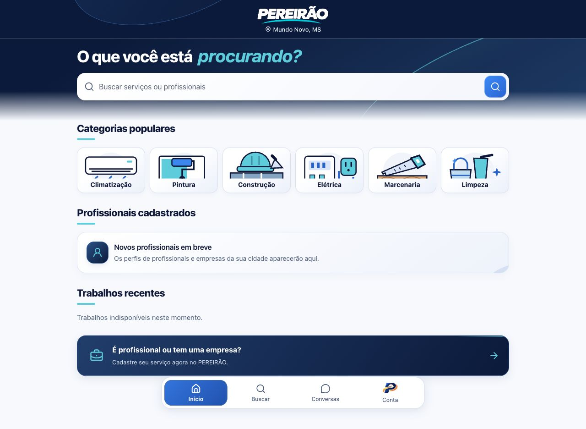

# Visual azul/turquesa — dependente da publicação aberta

Preserva estrutura, nomes/IDs/URLs das categorias, busca real e quatro abas. Navy como base; azul vivo em ações e navegação, turquesa em detalhes sobre navy e traços decorativos. Fundo frio, cards compactos e hero reduzido para aproximar o feed da primeira tela.

A marca é o PNG oficial do repositório, com os mesmos pixels/contorno. O filtro SVG existente torna o lettering branco no cabeçalho navy; somente a cor do traço inferior passa a turquesa. Nenhuma logo gerada por IA. As seis ilustrações são os SVGs originais recoloridos, sem imagens externas. A foto de limpeza da referência não foi usada nem criada no banco.

Tokens compartilhados deixam perfil, busca, conversas, posts e formulários consistentes. Textos brancos nos botões azuis; turquesa claro não é usado como texto pequeno sobre fundo branco. Mantém safe areas, foco e movimento reduzido existentes.

Não contém SQL, regras financeiras nem publicação de conteúdo. Só integrar após migrações da publicação aberta especificamente autorizadas e validadas e os checks dos PRs pais e deste aprovados. Capturas locais são evidência de layout emulado, não aceite físico Safari/iPhone.

## Capturas implementadas — navegador local, não Safari físico

Geometria DOM conferida em 320, 375, 390, 393, 430, 768, 1024, 1280 e 1440 px: marca no centro da viewport (desvio 0 px), seis categorias, quatro abas, sem overflow horizontal. Resultado bruto em publication/evidence/layout.json. Não há sessão nem conteúdo operacional no servidor local; feed não configurado informa indisponibilidade, sem conteúdo fictício. O feed real só será validado após a implantação autorizada da base e ações de duas contas legítimas.
