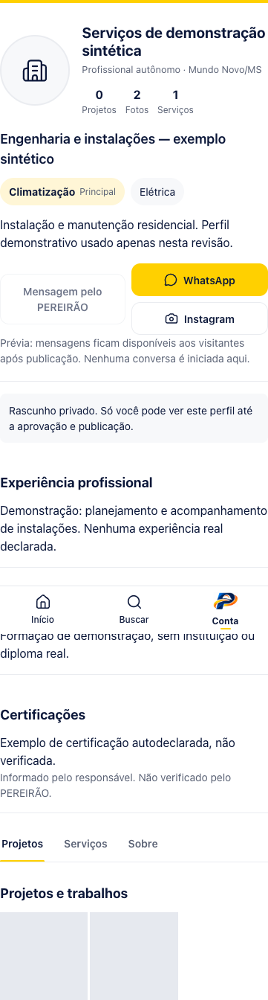
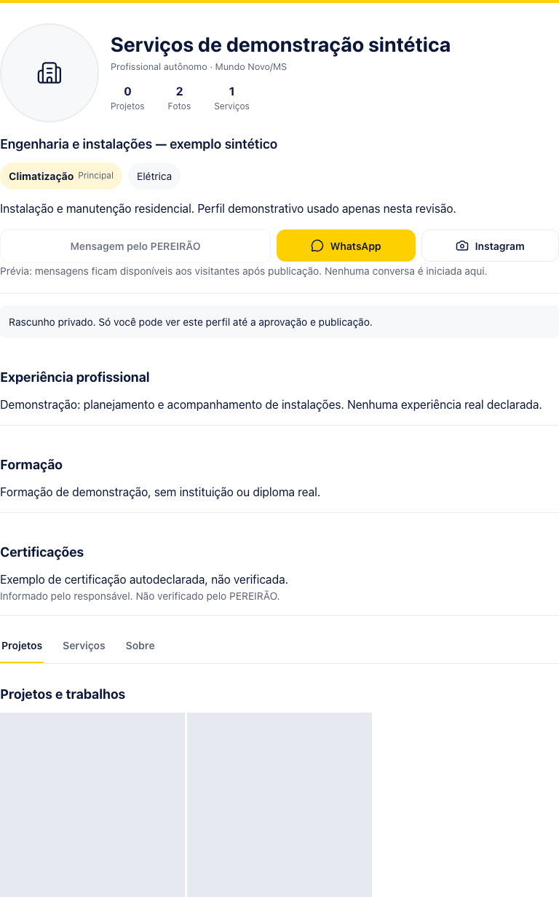

# Vitrine profissional — proposta dependente do PR #38

Escopo: título profissional, bio existente, cidade/atendimento, especialidades,
serviços/preços, trajetória/formação e credenciais opcionais, projetos e contatos.
Sem seguidores, endossos, avaliações inventadas ou selo de verificação.

## Auditoria

businesses possui name/description, localização, contatos e foto, mas não possui
headline, experiência, formação, certificações ou registro. profiles contém dados
da conta; business_details tem dados legais privados. Nenhum deles será exposto
para preencher a vitrine. Serviços e projetos usam tabelas já existentes.

## Esquema proposto — NÃO aplicado

20261122232908_business_presentation.sql cria business_presentations, 1:1 por
negócio, com headline(120), experience(3000), education(3000), certifications(2000)
e professional_registration(200). Tudo opcional, texto simples e limites no banco.
Atribuição é ao negócio, nunca importação automática do usuário Auth. Para empresa,
a UI pede histórico/qualificação da equipe com atribuição, sem CPF ou documento
privado; para autônomo pede trajetória/formação da própria vitrine.

RLS: visitante lê somente de published; owner/admin do negócio edita e lê seu
rascunho; administrador da plataforma lê para revisão. RPC invoker faz upsert
atômico sob RLS. O cliente não pode trocar business_id nem escrever status.
Os campos são autodeclarados, com aviso junto a certificações/registros. Não
constituem verificação por conselho ou pelo PEREIRÃO. Atualização de perfil já
publicado segue a autorização atual do titular; não introduz nova aprovação por
campo. Se moderação dessas alterações for desejada, definir fluxo antes da ativação.

## Compatibilidade / implantação / reversão

Expansão sem backfill: nenhuma linha existente alterada, nenhuma RPC antiga
substituída. Clientes antigos ignoram a nova tabela. Sem tabela, leitura pública
omite as seções opcionais; editor novo informa indisponibilidade e impede salvar.
Erros de autorização/rede não são tratados como tabela ausente. Não há fallback
que finja persistência. Só dados relidos após salvar alimentam a prévia.

Ordem futura: homologar foto e decidir #36; atualizar/decidir #38 sobre main;
preservar o cabeçalho #39 na atualização; revisar este PR e SQL; autorização
remota específica; aplicar só a nova migração e validar em leitura; ensaio real
consentido; decisão separada de merge. Reversão conservadora: voltar código e
manter tabela/dados. Não executar DROP nem excluir dados como rollback automático.
Nada publica negócio, inicia gratuidade, altera isenção ou ativa finanças.

## Proposta separada para faixa de preço

Ver service-price-range-proposal.md, herdado de #38. Este PR não muda os três
modos ou o CHECK de serviços e não confunde serviço com assinatura da plataforma.

## Aceitação / limitações

UI: salvar/cancelar, falha preserva edição, remontagem recupera dados simulados;
preview usa dados gravados, seções vazias omitidas; campos e texto são acessíveis.
SQL/RLS: ensaio local nativo, sem Docker, para owner/terceiro/anon, limite, pointer
imutável e published/unpublished. Nenhum teste gravou no Supabase operacional.
Capturas sintéticas ficam no QA de Preview, nunca no marketplace real. Recarga
real/autenticação/permissões com duas contas legítimas dependem da aplicação
explicitamente autorizada e de ensaio posterior. Safari físico fica com titular.

Esses dados são exemplos em memória, identificados no QA. O Preview normal usa
a conta legítima e aguarda ativação dos campos novos; o caminho QA é separado.
PR #39 não foi mesclado: este PR não altera AppShell nem MainNavigation e deve
preservar o único atalho global quando sua base for atualizada sobre a main que
contiver #39. Não restaurar o atalho duplicado no toolbar da Conta.
