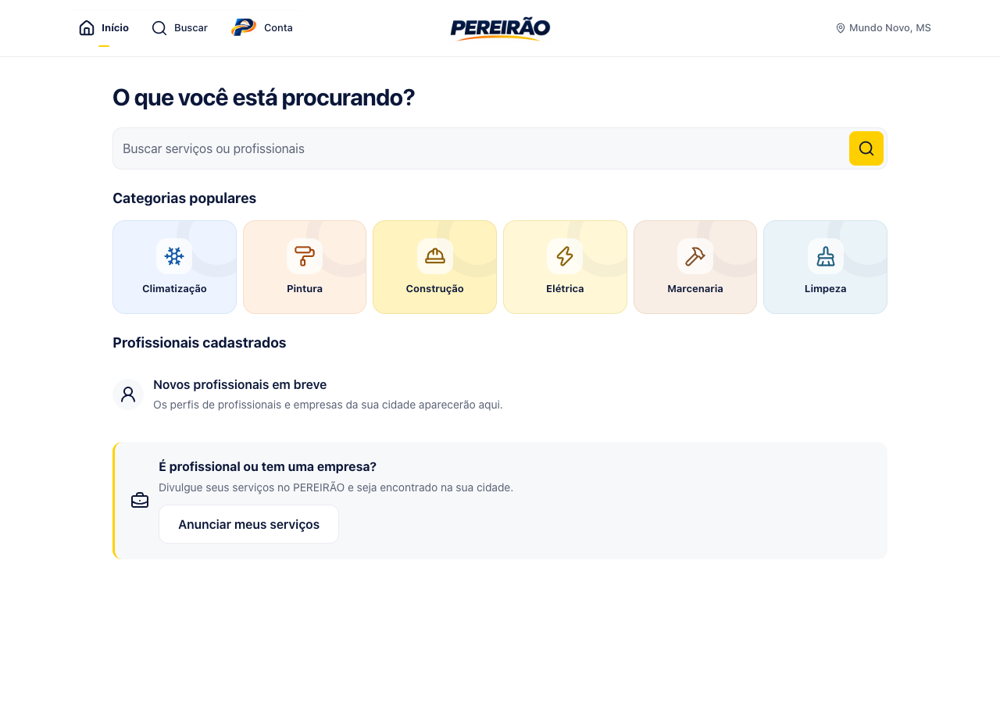

# Categorias — direção visual para avaliação

Proposta independente, baseada na main ff88eb80030aeed612c071006afc2fa9c0fe8449.
Não integra os PRs #36, #38 ou #39 e não autoriza merge.

Cards com superfícies claras em tons da marca, ícones vetoriais já existentes,
texto azul-marinho e bordas discretas. Três colunas no celular e seis a partir de
768 CSS px. Nomes e destinos `/buscar?categoria=<id>` permanecem iguais.
Não há emojis, fotografias de prestadores ou requisições de imagens externas.
O suporte a futuras fotografias oficiais e ao fallback de erro foi preservado.

As capturas mostram dados vazios locais, com configuração Supabase vazia e
requisições externas bloqueadas. Não mostram produção, perfil fictício ou Safari
físico. O cabeçalho ainda é o da main: mensagens do #39 são outra entrega.

## Validação

- 26 testes direcionados de Home/busca: nomes, filtros, seis destinos e fallback
  de futura imagem oficial preservados.
- Typecheck, build e diff check.
- Chromium headless local: 320, 375, 390, 393 × 852, 430, 768, 1024, 1280 e 1440 px.
  Em todas: seis cards, alvos maiores que 44px, textos dentro do card, três abas,
  marca central com erro inferior a 1px, sem overflow horizontal; nenhuma chamada
  externa ou erro JavaScript. Resultados em screenshots/categories/layout.json.
- Isto não valida VoiceOver, Safari, teclado/zoom do aparelho ou instalação PWA.
- Para reproduzir: usar scripts/categories-visual-qa.mjs com PUPPETEER_MODULE
  apontando para puppeteer-core já instalado, e opcionalmente CHROME_PATH e
  QA_OUTPUT. O script não instala dependências nem usa sessão de navegador.
- Build conserva aviso preexistente de import estático/dinâmico do ProfilePreviewPage.

## Revisão e integração

Antes de integrar, titular avalia a direção no Preview e nas duas capturas.
As mesmas seis categorias devem continuar abrindo a busca correta, inclusive via
teclado. Cor não é a única identificação: cada card mantém texto e ícone.
Nenhum esquema, estado comercial, dado pessoal ou regra de pagamentos mudou.
