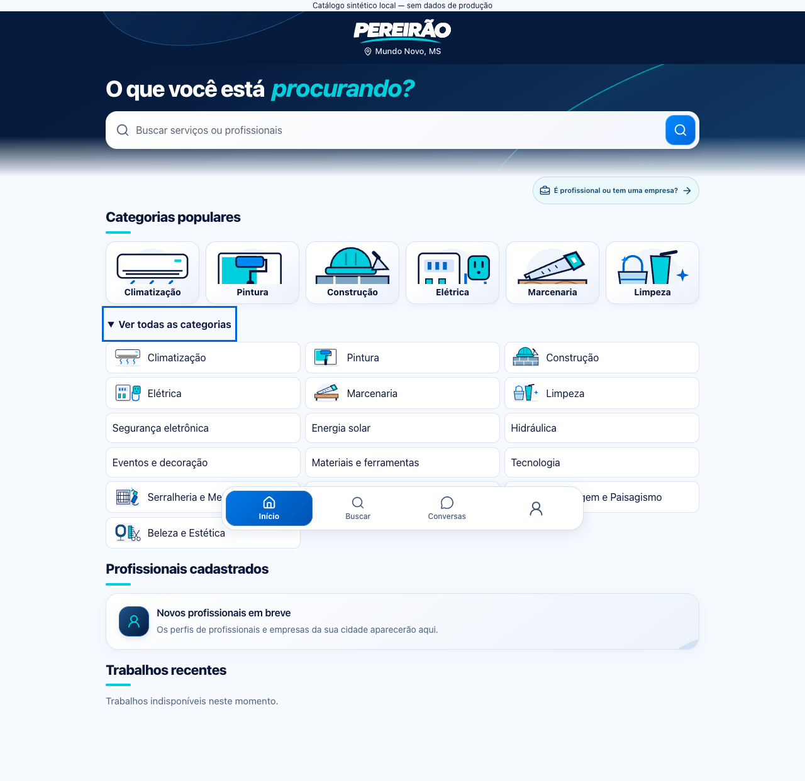
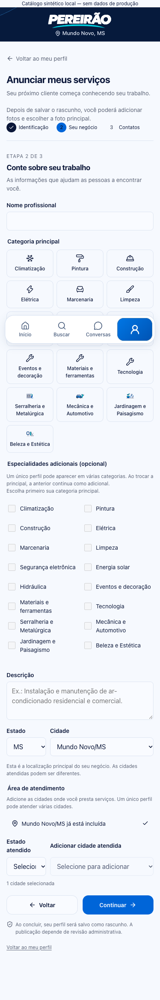

# Catálogo ativo de 16 categorias — proposta

## Problemas corrigidos

O cadastro já consultava `categories` ativas, mas o fallback público descartava IDs ausentes das seis ilustrações. A busca unificada consultava áreas e só filtrava profissionais por ofertas, ignorando a categoria principal/adicional declarada quando não havia oferta.

A UI agora lê o catálogo ativo `categories` pelo cliente público sem sessão privada. O filtro aceita IDs com sintaxe válida sem whitelist estática, conserva seleção durante carregamento e mantém ID/cidade na URL, paginação e histórico. Categoria desconhecida não vira silenciosamente uma busca sem filtro. Falha no catálogo oferece tentativa novamente.

As seis ilustrações e destinos permanecem intactos. “Ver todas as categorias” abre uma lista nativa compacta e acessível. Os quatro SVGs novos são originais, sem fontes externas ou fotos. `src/config/categories.ts` define apenas o recorte popular e os recursos visuais.

A alteração de `search_unified` inclui categorias declaradas ativas no filtro/nome de profissionais e no filtro dos projetos. Não infere serviços ou produtos a partir do nome da categoria, não amplia a projeção pública e mantém os predicados de publicação/suspensão existentes.

## Preflight remoto — 27/11/2026

- Projeto exclusivo: `yazdjiwaksamizrbqewq` (pereiraoapp).
- Base: main `54eafc8e485437a1c3b6f203eed8367e49075ef6`.
- Histórico remoto: 28 migrações, última `20261125183249_offers_unified_search`; 12 categorias e 12 áreas de ofertas ativas. As quatro novas não existem.
- Arquivo: `20261127185515_marketplace_sixteen_categories.sql`.
- SHA-256: `9df00800a675cafc8578f29526f85fd269ee6605c890d2bd369c7d3c6a103688`.
- Dry-run CLI 3.4, `db push --remote=yazdjiwaksamizrbqewq --dry-run --skip-vault`: listou exclusivamente esse arquivo; seeds/roles vazios. Nenhuma aplicação realizada.
- SQL: insere quatro categorias e quatro áreas com mesmos IDs, `ON CONFLICT DO NOTHING`; substitui somente a RPC `search_unified`, com a mesma assinatura e grants anon/authenticated. Não modifica registros anteriores, RLS, Storage, contratos, conteúdo ou estados de publicação.
- Dependências: categories, business_categories, offer_areas, private.offer_rows/offer_score/business_is_public/work_post_is_public/personal_post_public já aplicadas. Horários #87 não são dependência e não fazem parte do dry-run.

## Testes e limites

Teste local PostgreSQL 17 aplica a migração duas vezes, compara as 12 linhas anteriores e registros de negócios/serviços/especialidades, seleciona as 16 categorias como principais/adicionais, bloqueia outro responsável, rejeita escrita anon no catálogo, verifica busca nominal com/sem acentos, região, paginação, rascunhos, suspensão e compatibilidade da RPC legada. Publicação dos fixtures ocorre somente nesse banco descartável, sem acesso remoto.

Interface: catálogo atrasado mantém seleção, 16 opções, filtros/URL/histórico/paginação, cadastro e edição de autônomo/empresa sem recriar o negócio. SDK com HTTP interceptado verifica `active=eq.true` e projeção `id,name`.

Renderização local Chromium com catálogo sintético: Home/lista em 320, 375, 390, 393, 430, 768, 1024, 1280 e 1440 px; cadastro/edição em 320, 393 e 1280 px. Sem overflow, marca centralizada, quatro abas e links de ao menos 44 px. O summary foi aberto por tecla Espaço. Sem erro JS ou chamada externa. Não é Safari/iPhone nem Android físico.

## Implantação após revisão — não executada

1. Revisar PR e reconfirmar projeto, hash, histórico e dry-run exclusivo.
2. Obter autorização específica para este SQL. Aplicar só o arquivo; validar catálogo/grants e preservação dos registros em leitura.
3. Conferir CI/base/diff e obter decisão de merge. Código antigo é compatível com a expansão aditiva e a assinatura da RPC permanece igual.
4. Integrar código, aguardar Vercel READY e conferir SHA/domínio.
5. Validar em conta legítima os novos filtros/categorias; não publicar conteúdo para testar.

Sem SQL remoto, o Preview normal apresenta as 12 categorias reais; as quatro novas só entram no catálogo depois da migração autorizada. As capturas de 16 opções são explicitamente locais/sintéticas, sem cadastros fictícios operacionais.

## Contenção

Uma falha na transação reverte os inserts e a definição da função. Depois de aplicada, preservar as categorias/áreas e seus vínculos: não apagar linhas ou desativá-las automaticamente. Conter revertendo o código e, se indispensável, propor restauração da definição anterior de `search_unified` em SQL específico revisado e autorizado. A restauração anterior perde o novo filtro de perfis sem ofertas; não realizar rollback cego. Não há janela planejada de indisponibilidade, nem alteração em mensagens, notificações, pagamentos ou assinaturas.

## Reconciliação de histórico — 27/11/2026

A migração foi aplicada no Supabase de produção com a versão registrada `20261127192706` e o nome `marketplace_sixteen_categories` (mesmo SQL e SHA-256 acima). O arquivo versionado foi renomeado de `20261127185515_marketplace_sixteen_categories.sql` para `20261127192706_marketplace_sixteen_categories.sql` para coincidir com o histórico remoto e impedir reaplicação pelo `db push`. O runner local usa o novo caminho. Esta correção não executa SQL e não altera migrações financeiras.
