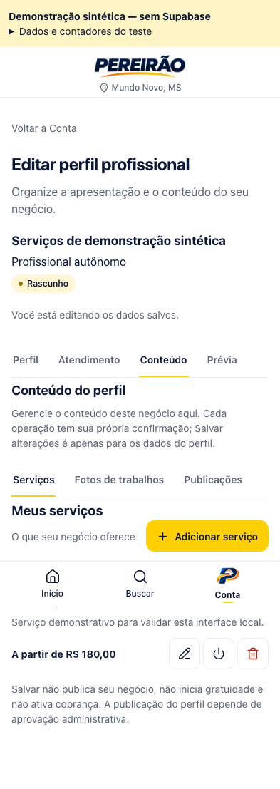
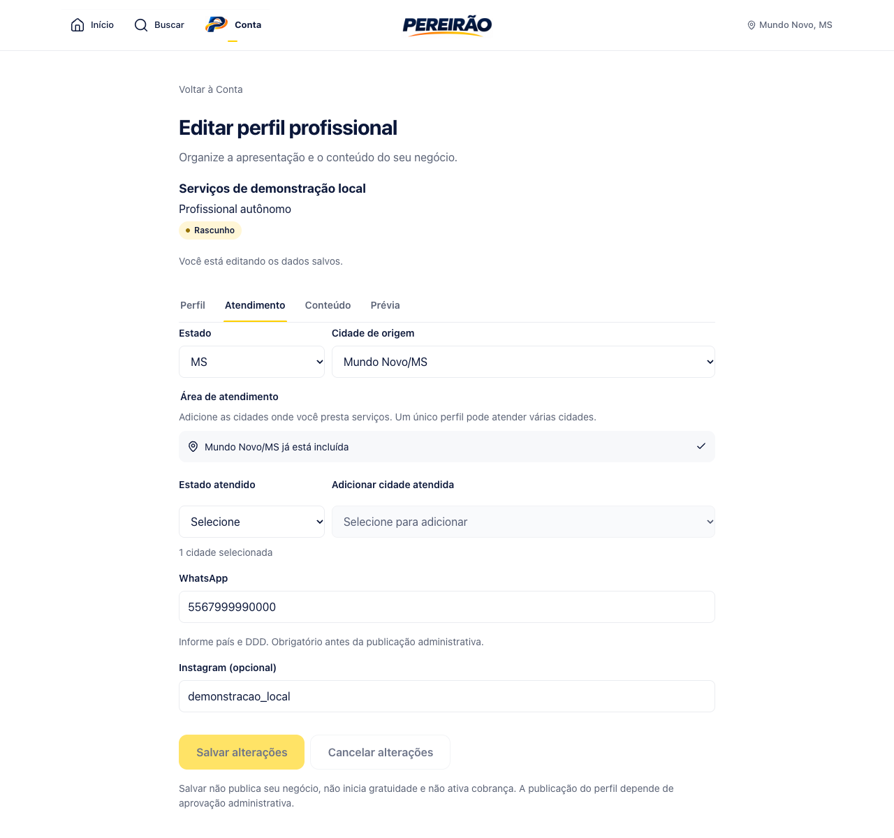

# Editar perfil profissional — área central

## Escopo e dependência

Branch `feat/editar-perfil-central`, PR empilhado sobre `feat/foto-principal-direta` (#36, SHA `361b5c993453e9d17e84161983087a88ff1c47d7`). A base já incorpora a main `ff88eb80030aeed612c071006afc2fa9c0fe8449`. Este PR não adiciona ou altera migrações.

O cadastro inicial continua em `/conta/profissional/cadastro`, com três etapas. Um perfil existente usa `/conta/profissional/:businessId/editar`: quatro seções internas — Perfil, Atendimento, Conteúdo e Prévia — sem nova aba principal.

- **Perfil:** foto redonda/seletor do #36, tipo, nome, bio, categoria principal e especialidades.
- **Atendimento:** cidade de origem, áreas múltiplas, WhatsApp e Instagram, com os seletores do catálogo existente.
- **Conteúdo:** gerenciadores reais embutidos em abas internas Serviços, Fotos de trabalhos e Publicações. Adição/edição, confirmações e listas funcionam na própria central; nenhum link de encaminhamento é necessário. As rotas antigas permanecem para deep links e retornam à seção e ao gerenciador do mesmo negócio.
- **Prévia:** consulta os dados salvos e os conteúdos existentes; não usa o formulário em edição. Não possui controles de edição duplicados. Para draft, permanece identificada como privada.

As seções ficam na query `secao`; o gerenciador interno fica em `conteudo=servicos|fotos|publicacoes`, inclusive os retornos. Links antigos `?secao=bio` abrem Perfil. A seleção do negócio está no ID da rota; voltar à Conta preserva esse ID em state. E-mail, senha, assinaturas, isenção e administração continuam em Conta. Razão social/CNPJ continuam editáveis em uma rota privada própria acessível pelas opções da Conta para empresas; não aparecem no editor público nem na prévia.

## Gravação e cancelamento

Salvar usa o `saveDraft` existente, com a mesma validação e verificação de responsável. O payload não define status, proprietário ou permissões. Após sucesso, a edição recarrega a fonte persistida e o snapshot de concorrência de especialidades. Não se apresenta um resultado otimista como se já estivesse salvo.

Trocar de seção preserva o formulário. Cancelar restaura o snapshot salvo sem chamada de escrita. Em falha, os campos continuam editáveis com seus valores; a prévia consulta somente dados persistidos. O backend existente salva múltiplas operações: uma falha parcial pode exigir recarga/conciliação; este PR não promete transação nova nem rollback automático dos dados. Submissões repetidas são bloqueadas enquanto uma gravação está em andamento.

Links internos, incluindo a navegação inferior, pedem confirmação para descartar edições. Recarga/fechamento usam beforeunload quando suportado. O navegador controla a disponibilidade desse aviso, especialmente no iOS; ele não garante retenção após encerramento forçado do processo ou retorno pelo histórico. Nenhum rascunho de formulário ou credencial é copiado para localStorage. O editor usa a proteção existente do PWA para rotas privadas/formulários e não altera seu cache.

## Foto principal versus trabalhos

Foto principal abre o input pelo gesto do usuário e reutiliza integralmente a preparação, prévia, confirmação, otimização e RPC/Storage privados do #36. A foto de trabalho continua no portfólio, com o nome explícito “Adicionar foto de trabalho”. Não há cópia de retrato para portfólio ou publicação. O campo de fotografia é independente do botão de salvar os dados textuais.

A migração `20261122184357_business_profile_images.sql` continua proposta no #36, sem aplicação remota. Antes dela, o botão não pode ser considerado operacional: a RPC prepare falha antes do upload e informa a pendência. O Preview compartilha o Supabase operacional quando não usa a fixture local; testes reais exigem autorização e sessão legítima. Este PR não homologa upload nem Safari físico.

## Verificações desta implementação

- 527 testes automatizados em 44 arquivos: cadastro inicial preservado, editor sem etapas, prévia gravada versus edição, salvar/cancelar, erro, bloqueio de duplo envio, gerenciadores embutidos, formulários sem aninhamento, seleção/prévia/cancelamento de foto sem envio, retorno das rotas antigas, negócio correto, visitante e falta de permissão, dados empresariais fora da área pública.
- Typecheck, build e diff --check.
- QA local em Chrome headless: Perfil/Atendimento/Conteúdo/Prévia em 320, 375, 390, 393×852, 430, 768, 1024, 1280 e 1440 px (36 combinações). Sem overflow horizontal, controles dentro da viewport, retrato circular, sem erro JS ou requisição externa.
- Capturas com dados sintéticos, sem profissionais fictícios no Supabase. O script `scripts/profile-editor-qa.mjs` usa uma fixture isolada e exige puppeteer-core/Chrome fornecidos pelo ambiente; não adiciona dependência ao aplicativo. PUPPETEER_MODULE, CHROME_PATH e QA_OUTPUT podem ser configurados localmente.
- CI do SHA atual deve passar antes da revisão; links e resultado ficam no corpo do PR. SQL/RLS roda somente em PostgreSQL descartável no CI, sem Docker. Não representa upload HTTP no Storage remoto.

## Demonstração no Preview, sem operações remotas

Somente em builds Vercel Preview, `scripts/build-editor-preview.mjs` gera uma segunda página em `/qa/profile-editor/index.html`. É uma aplicação separada com repositórios em memória, configuração Supabase vazia e serviços auxiliares desativados. O build de produção/default não contém essa página; ela não altera os controles de proteção da Vercel e não registra service worker próprio.

A página exibe “Demonstração sintética — sem Supabase”, rota interna e contadores de operações. Sua sessão é simulada, não autenticação homologada. Dados desaparecem ao recarregar. O script local de percurso utiliza a mesma fixture para testar Perfil → Atendimento → Conteúdo → Prévia, serviço em memória, seleção/prévia/cancelamento da foto de trabalho, publicação draft em memória e cancelamento do retrato separado. A execução no Preview é registrada no PR; não equivale a upload HTTP no Storage operacional.

## O que exige outra tela

Os gerenciadores de conteúdo não exigem outra página: formulários de serviço, foto e publicação abrem em modais da central, assim como confirmações e ampliação. A escolha do arquivo usa o seletor nativo do sistema. Conta, dados empresariais privados, acesso, assinatura e administração continuam em suas áreas próprias. As rotas antigas `/servicos`, `/trabalhos` e `/publicacoes` seguem disponíveis para links existentes, reutilizando os mesmos componentes e retornando ao gerenciador correto na central.

Não há formulário HTML envolvendo os gerenciadores: Perfil e Atendimento têm formulários separados. Salvar um serviço/foto/publicação nunca submete o formulário de bio/contatos. Atualizar mídia não sobrescreve o texto ainda não salvo. Prévia é carregada dos dados persistidos ao abri-la.

## Aceitação seguinte

1. Rever este PR como dependente do #36, sem integrar nenhum dos dois nesta rodada.
2. Após autorização, aplicar exclusivamente a expansão revisada do #36, confirmar RLS/bucket/RPCs e histórico.
3. Homologar retrato no Safari físico: seletor, cancelar, confirmar, falha, foto anterior, recarga, segundo plano, histórico e novo login; conferir objeto/ready sem portfólio indevido. O portfólio usa a estrutura existente e também precisa de ensaio real consentido; sua demonstração em memória não comprova upload.
4. Validar o editor com a conta legítima e autorizar qualquer gravação operacional necessária. CI/fixture não provam persistência real.
5. Depois da foto homologada, acompanhar cadastro legítimo → revisão → publicação administrativa consentida → busca → contato por mensagem e WhatsApp. Nenhum desses atos é autorizado automaticamente pelo merge ou pela gravação do perfil.

Sem novas funções financeiras, mudança nas cores das categorias, alteração de regras de aprovação/90 dias/isenção ou migração remota.
