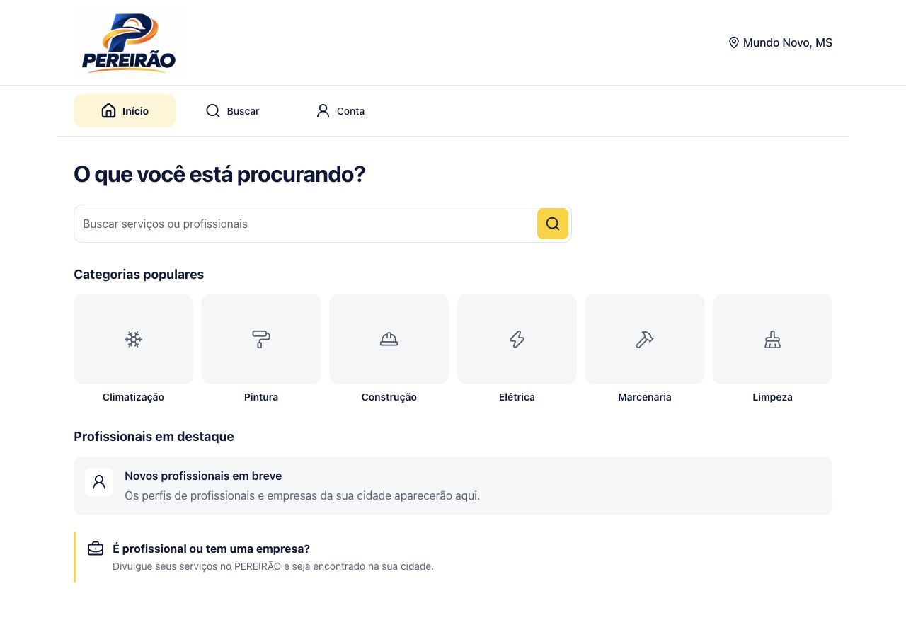

# PR #2 — Validação da tela inicial

## Alterações e limites

Logo original preservada com hash conferido e dois PNGs redimensionados proporcionalmente para o cabeçalho. O fundo branco e todos os elementos da composição foram mantidos. Não foi criado ícone quadrado, removido fundo ou redesenhado o P. O original e a documentação estão em `assets/brand`.

A tela inicial tem uma única busca pública, seis categorias, estado vazio de profissionais e convite sem botão fictício. Os parâmetros `q` e `categoria` chegam à rota `/buscar`. A página mostra o contexto recebido sem simular resultados. Termos vazios levam a `/buscar` sem parâmetro vazio; caracteres especiais são codificados por `URLSearchParams`.

As imagens oficiais de categorias ainda não foram fornecidas individualmente; todas usam placeholders neutros. A lista de profissionais está preparada para dados tipados, mas a integração Supabase e as rotas de perfil são etapas futuras. Mundo Novo/MS segue estático. Não há login, cobrança, agenda, chat ou novos destinos principais.

## Verificações automatizadas

- `npm run typecheck`: passou.
- `npm test`: 21 testes passaram, incluindo os seis testes originais adaptados à logo real e 15 testes/casos novos.
- `npm run build`: passou; sem nova dependência ou alteração do lockfile.
- `git diff --check`: passou.
- Hash SHA-256 do original copiado corresponde exatamente ao arquivo fornecido.

Os testes novos cobrem pesquisa com espaços, acentos e caracteres especiais; campo vazio; navegação pelas seis categorias; acesso direto com parâmetros; categoria desconhecida; logo acessível; estado vazio sem resultados fictícios; fallback de imagem; avaliação opcional na estrutura futura.

## Inspeção local em navegador

| Viewport | Resultado |
|---|---|
| 375 × 812 | Três colunas; navegação inferior; largura do documento 375 px; convite final acessível por rolagem, acima da navegação |
| 390 × 844 | Três colunas; largura do documento 390 px; sem rolagem horizontal |
| 768 × 1024 | Seis colunas; navegação horizontal única; largura do documento 768 px |
| 1280 × 900 | Conteúdo com largura máxima de 1120 px; seis colunas; largura do documento 1280 px |

A captura completa de 390 px foi feita adicionalmente com altura de 1050 px para mostrar o conteúdo e a navegação sem a sobreposição que barras fixas produzem em capturas longas. Em 375 px também foi registrada a posição após rolar até o final.

Logo observada no cabeçalho a 156 × 104 px, preservando proporção 3:2; composição legível, com as fontes PNG de 384 × 256 e 768 × 512. Sem distorção, corte ou remoção de fundo. Não foi testado em aparelhos físicos ou em todos os níveis de densidade de tela.

No navegador: pesquisa por `instalação elétrica` chegou a `/buscar?q=instala%C3%A7%C3%A3o+el%C3%A9trica`; link de Climatização chegou a `/buscar?categoria=climatizacao`. Console sem erros ou avisos capturados durante a inspeção. As seis categorias também foram verificadas nos testes automatizados.

## Capturas

[375 px, topo](screenshots/pr2/inicio-375.jpg) · [375 px, final após rolagem](screenshots/pr2/inicio-375-final.jpg) · [768 px](screenshots/pr2/inicio-768.jpg)

## Integração

O workflow do GitHub Actions executa instalação, tipos, testes e build. O resultado deve ser conferido no PR antes do merge. Não há workflow de deploy. Nenhum acesso de escrita ao Supabase foi utilizado. Não foi configurada ou acionada publicação na Vercel/Lovable.
